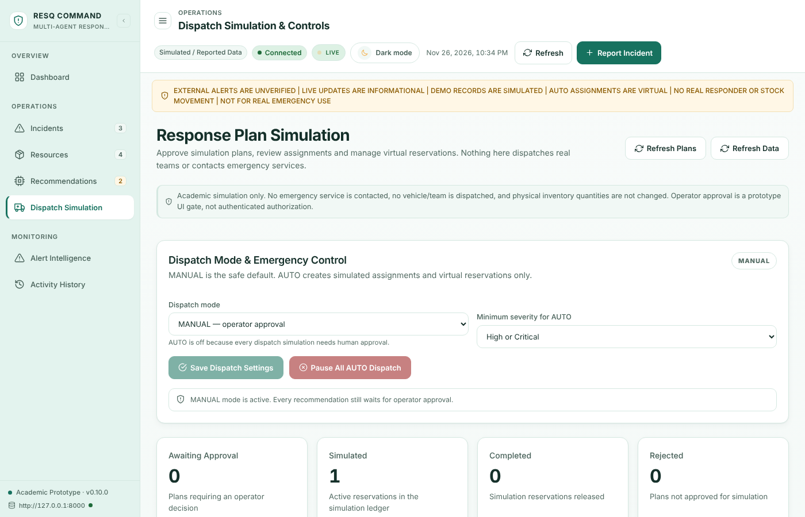

# Autonomous Multi-Agent Disaster Relief & Emergency Dispatch Engine

**Final project report (draft)** · GLA University · B.Tech CS (AI/ML) · 2026-2027

> ACADEMIC PROTOTYPE | DEMO DATA IS SIMULATED | AUTO DISPATCH IS VIRTUAL | NOT FOR REAL EMERGENCIES

**Team:** Kinjal Mishra, Himanshu Saini, Jatin Kumar, Jayant Choudhary
**Guides:** Mr. Preshit Desai and Ms. Anushka Shukla

> Draft for the team to review. Adapt it to the college format and add the usability
> results, individual contributions and actual project timeline.

## 1. Abstract

This academic prototype supports reports for hazards such as cyclones, floods and earthquakes. It integrates GDACS/USGS public alerts with manually entered reports, runs five incident agents, calculates rule-based severity, prioritises affected areas, and recommends rescue teams, ambulances, shelters and supplies. Recommendation approval revalidates current stock. Optional AUTO creates virtual assignments only. A real-time React dashboard presents alerts, incident/resource locations, availability and simulated response operations through SSE. It is not connected to real emergency services.

## 2. Problem and objectives

Coordinators facing several incidents need to compare severity, identify urgent areas and
see suitable resources. The objectives are to record incidents, validate them, score and
rank them transparently, match resources, record operator decisions, and show the results
in one dashboard.

## 3. Architecture

React 19 and Vite → REST API (FastAPI) → five Python agents → SQLite. The dashboard
receives refresh signals through Server-Sent Events.

| Agent | Responsibility |
|---|---|
| Monitoring | Normalises reports and prepares a draft assessment for human checking |
| Severity | Applies the six-factor rule set |
| Prioritization | Orders open incidents and explains each position |
| Resource Allocation | Matches needs to available stock |
| Notification | Prepares alerts and the operator summary |

An optional OpenAI-compatible language model can add explanatory text and draft
suggestions. It is off by default and cannot change scores, ranking or allocations.

## 4. Workflow

1. An operator reviews an external GDACS/USGS alert or submits a manual report, optionally specifying vulnerable groups at risk.
2. It is validated, normalised, saved and scored.
3. The agents run and a pending recommendation is created.
4. Approval rechecks current resource availability in a transaction; a stale or over-allocated request returns HTTP 409 and remains pending. Rejection does not require available stock.
5. For an approved one, the operator creates a response plan and approves it, which
   reserves stock in the simulation ledger.
6. Alerts update and the actions are recorded.

AUTO simulation remains available as an explicit opt-in. It creates only virtual database assignments and reservations; no real responder, ambulance or shelter is dispatched.

## 5. Method

**Severity (0–100):** people affected (35), immediate help (20), hazard type (10),
hazard signal (15), recency (15), vulnerable population (5). Levels: Low below 25,
Medium from 25, High from 50, Critical from 75. The vulnerable-population factor remains capped at 5: explicitly reported children, elderly, hospital, school, pregnant_women or disabled groups take precedence, while description/location keywords remain the fallback when no explicit group is selected.

**Priority:** score, then people affected, then earlier report time, then lower ID.

**Allocation:** each help need maps to a resource type. Demonstration assumptions
are one rescue-team unit per 200 people, one ambulance unit per 100 people, one shelter
or supply unit per person, and one other-resource unit per 25 people. Nearer resources
come first when coordinates exist. Recommendations do not exceed currently available
stock, and shortages are reported. These are illustrative academic assumptions, not
validated staffing or emergency-response guidance.

## 6. Technology

React 19, Vite 6, Leaflet with OpenStreetMap tiles, Python, FastAPI, SQLite, pytest,
Git and GitHub.

## 7. Testing

On 27 November 2026, 282 backend tests passed (one existing Starlette/httpx deprecation warning) and the frontend production build passed. See TEST_REPORT.md for coverage and manual verification limitations.
See `TEST_REPORT.md` for coverage and gaps. The classmate usability review is pending.

## 8. Screenshots

All screenshots use **simulated** data. Map backgrounds did not load where they were
captured; retake the map views with an internet connection.

## 9. Limitations

No login or roles; unvalidated severity weights and demonstration allocation ratios; straight-line distances only; vulnerable groups are operator-reported with keyword fallback only when no groups are selected; live resource inventory integration is absent; not suitable for real emergency use.

## 10. Future work

Role-based login, verified resource inventory integrations, road-distance estimates, map clustering, multilingual support, shared health state for multi-worker feed sync, and model evaluation if a suitable labelled dataset becomes available.

## 11. References

1. World Meteorological Organization, "Early Warnings for All."
2. UNDRR, "Leveraging AI to enhance multi-hazard early warning systems," 2026.
3. React, "Quick Start." https://react.dev/learn
4. FastAPI, "First Steps." https://fastapi.tiangolo.com/tutorial/first-steps/
5. Leaflet, "Quick Start Guide." https://leafletjs.com/examples/quick-start/
6. Python Software Foundation, "The Python Tutorial." https://docs.python.org/3/tutorial/
