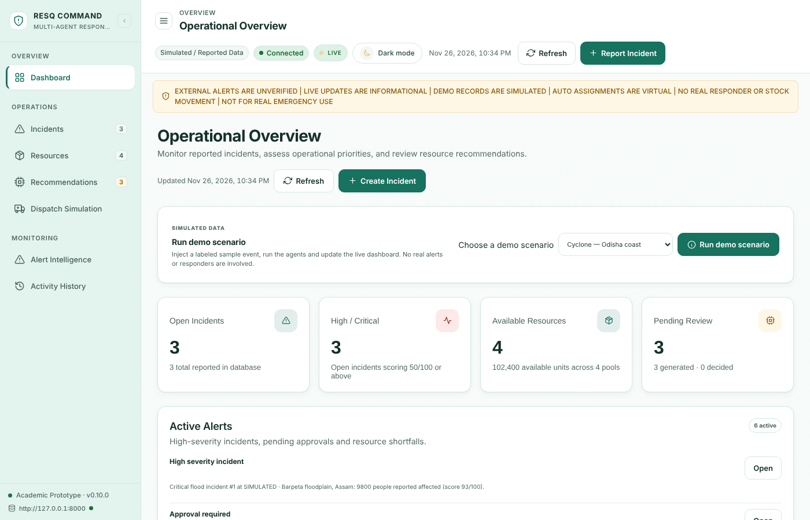
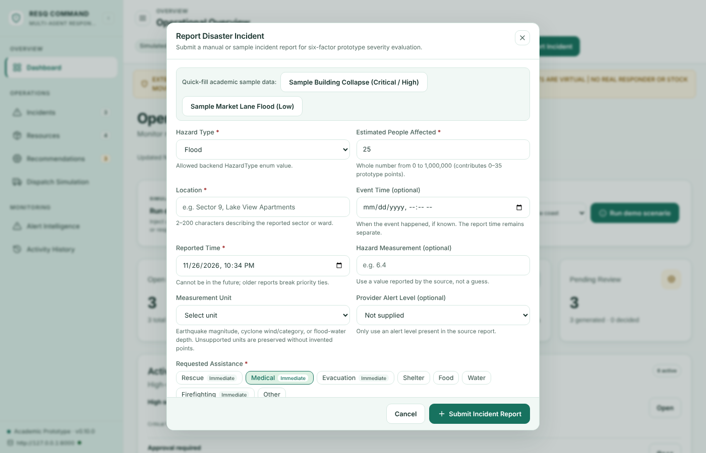
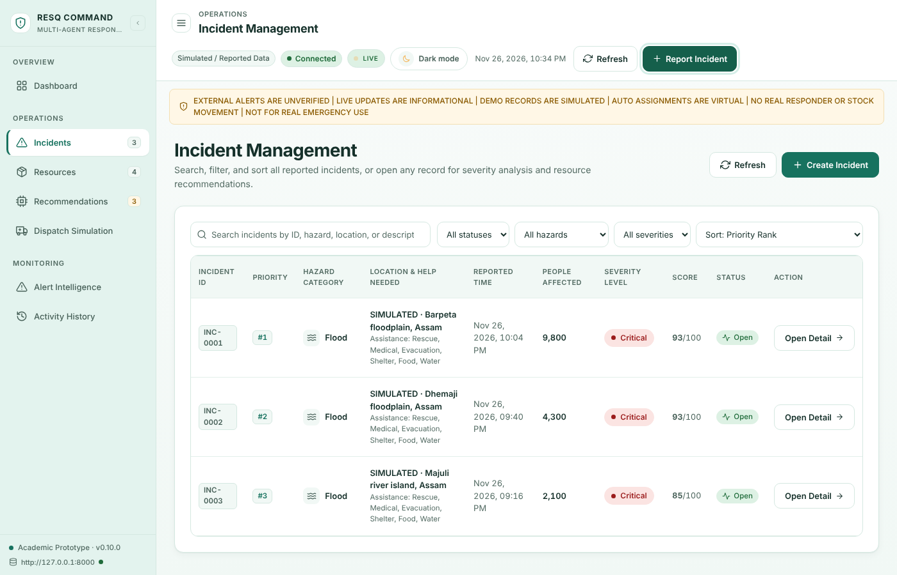
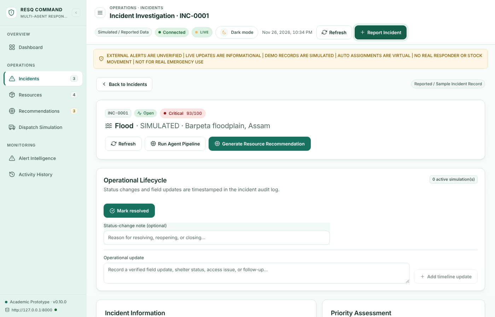
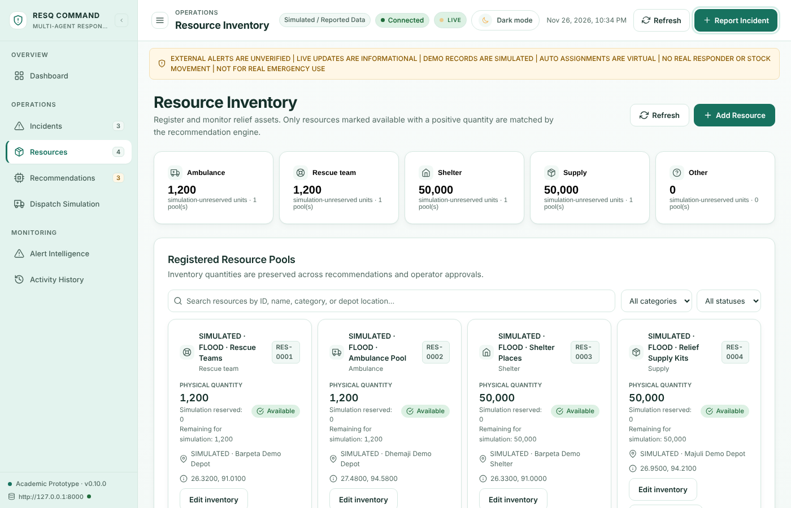
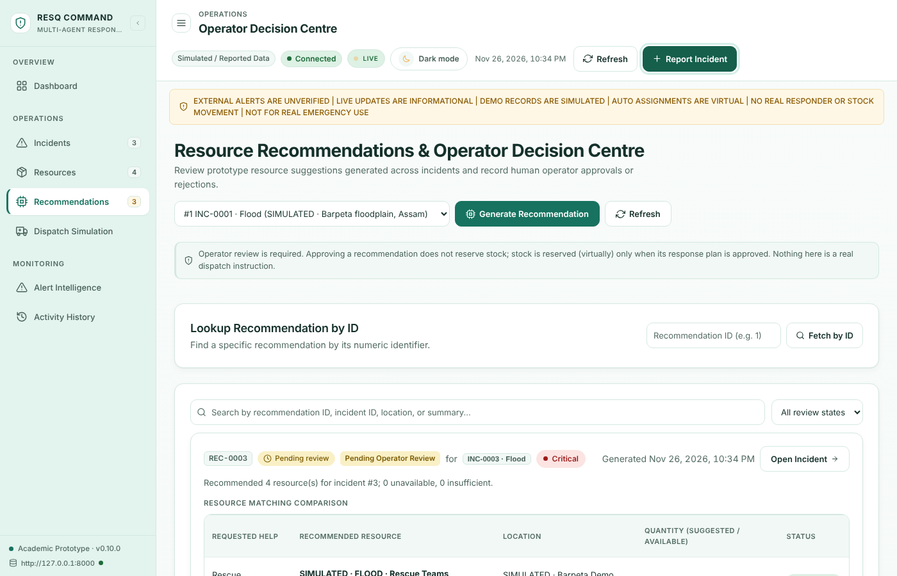
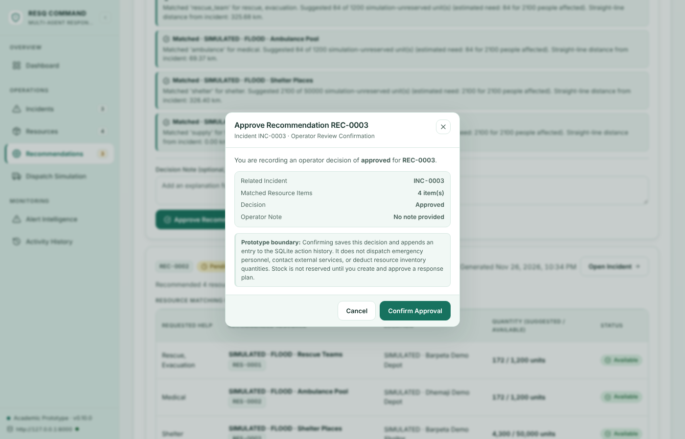
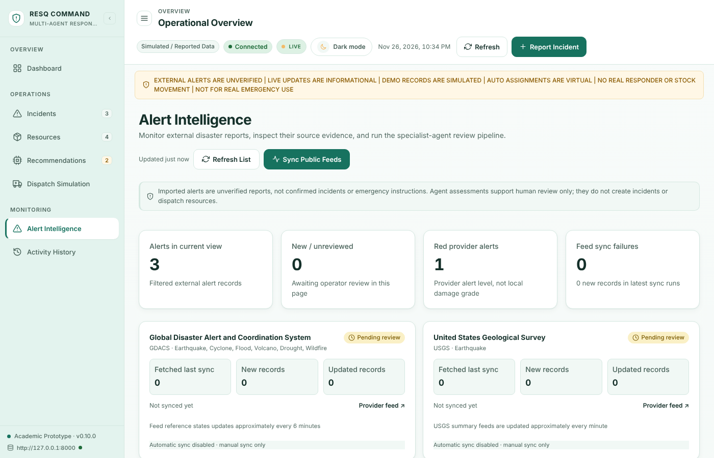
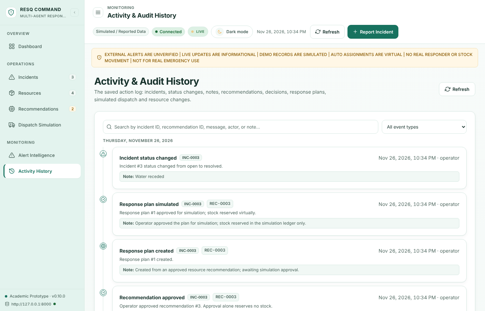

# Autonomous Multi-Agent Disaster Relief & Emergency Dispatch Engine

**Final project report (draft)** · GLA University · B.Tech CS (AI/ML) · 2026-2027

**Team:** Kinjal Mishra, Himanshu Saini, Jatin Kumar, Jayant Choudhary
**Guides:** Mr. Preshit Desai and Ms. Anushka Shukla

> Draft for the team to review. Adapt it to the college format and add the usability
> results, individual contributions and actual project timeline.

## 1. Abstract

This academic prototype organises disaster incident reports, scores their severity with
documented rules, ranks them, and recommends resources for an operator to approve or
reject. A React dashboard shows incidents, a Leaflet map, resources, alerts and action
history. A FastAPI service coordinates five agents and stores records in SQLite. It is
decision support only and is not connected to real emergency services.

## 2. Problem and objectives

Coordinators facing several incidents need to compare severity, identify urgent areas and
see suitable resources. The objectives are to record incidents, validate them, score and
rank them transparently, match resources, record operator decisions, and show the results
in one dashboard.

## 3. Architecture

React 19 and Vite → REST API (FastAPI) → five Python agents → SQLite. The dashboard
receives refresh signals through Server-Sent Events.

| Agent | Responsibility |
|---|---|
| Monitoring | Normalises reports and prepares a draft assessment for human checking |
| Severity | Applies the six-factor rule set |
| Prioritization | Orders open incidents and explains each position |
| Resource Allocation | Matches needs to available stock |
| Notification | Prepares alerts and the operator summary |

An optional OpenAI-compatible language model can add explanatory text and draft
suggestions. It is off by default and cannot change scores, ranking or allocations.

## 4. Workflow

1. An operator submits a report.
2. It is validated, normalised, saved and scored.
3. The agents run and a pending recommendation is created.
4. The operator approves or rejects it.
5. For an approved one, the operator creates a response plan and approves it, which
   reserves stock in the simulation ledger.
6. Alerts update and the actions are recorded.

An optional AUTO simulation exists from earlier development. It is disabled by default
because it skips human review.

## 5. Method

**Severity (0–100):** people affected (35), immediate help (20), hazard type (10),
hazard signal (15), recency (15), vulnerable population (5). Levels: Low below 25,
Medium from 25, High from 50, Critical from 75.

**Priority:** score, then people affected, then earlier report time, then lower ID.

**Allocation:** each help need maps to a resource type. The estimate is one shelter or
supply unit per person and one team or ambulance unit per 25 people. Nearer resources
come first when coordinates exist. A recommendation never exceeds available stock, and
shortfalls are reported. These ratios are demonstration assumptions.

## 6. Technology

React 19, Vite 6, Leaflet with OpenStreetMap tiles, Python, FastAPI, SQLite, pytest,
Git and GitHub.

## 7. Testing

On 26 November 2026, 260 backend tests passed and the frontend built successfully.
See `TEST_REPORT.md` for coverage and gaps. The classmate usability review is pending.

## 8. Screenshots

All screenshots use **simulated** data. Map backgrounds did not load where they were
captured; retake the map views with an internet connection.

## 9. Limitations

No login or roles; unvalidated severity weights and allocation ratios; straight-line
distances only; keyword-based vulnerability detection; user-entered or sample data; not
suitable for real emergency use.

## 10. Future work

Role-based login, verified data feeds, road-distance estimates, map clustering,
multilingual and offline support, and model evaluation if a suitable labelled dataset
becomes available.

## 11. References

1. World Meteorological Organization, "Early Warnings for All."
2. UNDRR, "Leveraging AI to enhance multi-hazard early warning systems," 2026.
3. React, "Quick Start." https://react.dev/learn
4. FastAPI, "First Steps." https://fastapi.tiangolo.com/tutorial/first-steps/
5. Leaflet, "Quick Start Guide." https://leafletjs.com/examples/quick-start/
6. Python Software Foundation, "The Python Tutorial." https://docs.python.org/3/tutorial/
